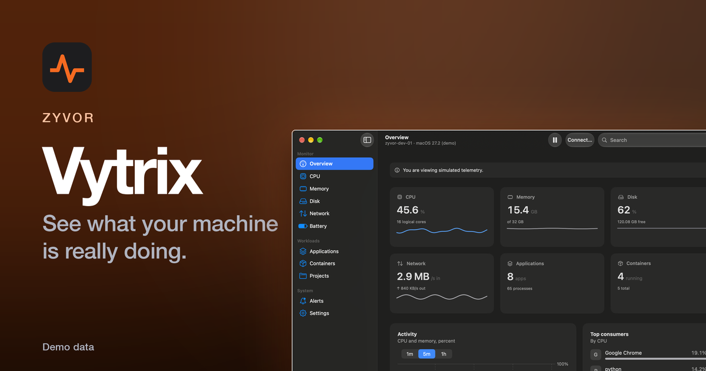
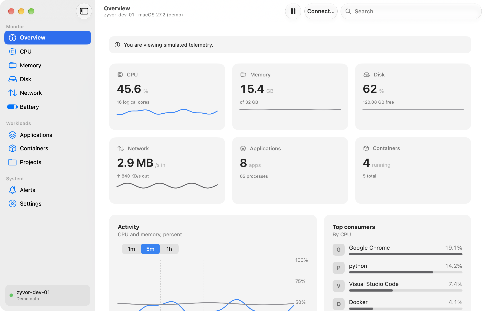
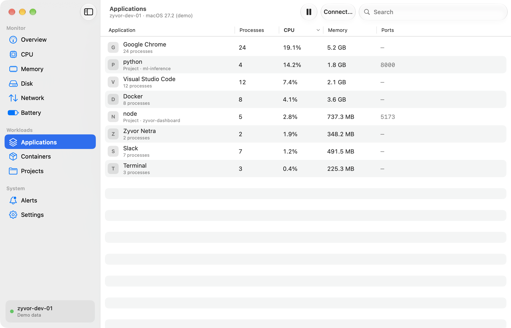
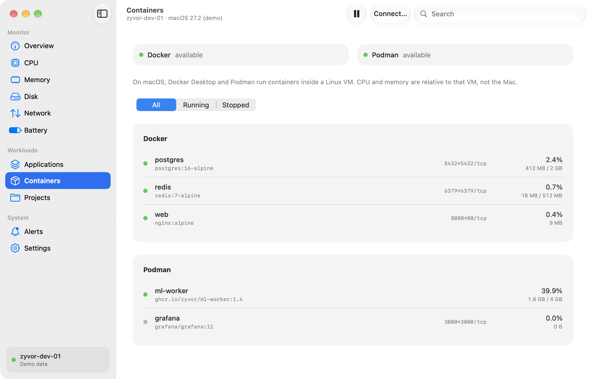
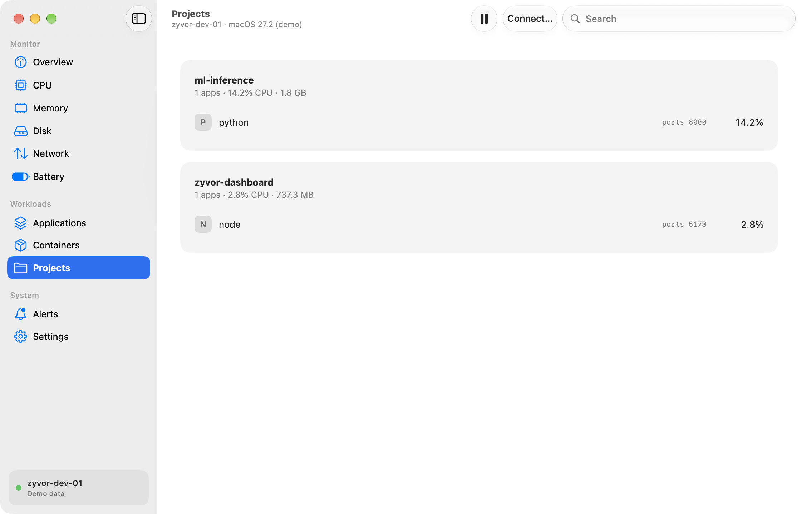
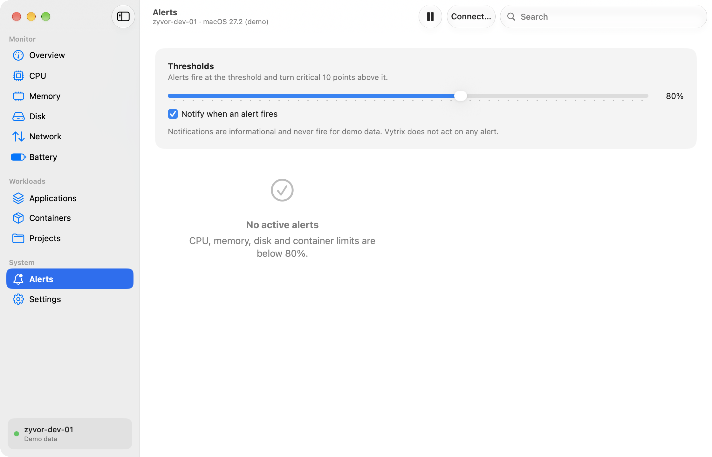

# Vytrix

### See what your machine is really doing.

A read-only system activity monitor for macOS. It never kills, signals or changes anything.

 

**[Download the 30-day trial](https://github.com/zyvorai/vytrix/releases/tag/v0.9.0)** &nbsp;·&nbsp; [Website](https://zyvorai.github.io/vytrix/) &nbsp;·&nbsp; [Buy a licence](https://zyvor.dev/buy)

`Vytrix-0.9.0.dmg` · macOS 26 or later, Apple silicon only · Developer ID signed and notarized

---

## Download (trial)

| | |
| --- | --- |
| **Get it** | [Vytrix 0.9.0](https://github.com/zyvorai/vytrix/releases/tag/v0.9.0): `Vytrix-0.9.0.dmg` (the SHA-256 is in the release notes and in `Vytrix-0.9.0.dmg.sha256`) |
| **Trial key** | The app runs without a key. For a free 30-day trial key, email **sales@zyvor.dev**. The trial is soft: nothing is disabled and no data is lost when it ends |
| **Requirements** | macOS 26 or later, Apple silicon only. Needs Python 3.10 or newer on your Mac for the collector (for example `brew install python`), or a collector running elsewhere |
| **Notarized** | Developer ID signed and notarized by Apple |

Open the DMG and drag Vytrix to Applications.

## See it

*Screenshots are the native app on simulated telemetry (demo data).*

| Overview | Applications |
| --- | --- |
|  |  |
|  |  |

| Containers | Projects | Alerts |
| --- | --- | --- |
|  |  |  |

## What it does

- **Overview:** CPU, memory, disk and network and the busiest applications on one screen. A counter that is not available is shown as absent, never as zero.
- **Applications:** processes grouped by executable or `.app` bundle, with CPU and memory per application and a process sheet.
- **Containers:** state, CPU, memory against the limit and published ports, from read-only calls.
- **Projects:** listening ports tied to the application and its project folder.
- **Alerts:** thresholds on CPU, memory, disk and containers, at a level you set. Notifications are informational; Vytrix does not act on any alert.
- **Menu bar:** CPU, host totals, alert count and the busiest apps; closing the window keeps Vytrix in the menu bar.
- **Read-only and local-first:** it never kills, signals or changes anything, and history stays on your Mac.

### New in 0.9.0

- Capacity outlook: local trend and anomaly detection with a time-to-limit estimate for CPU, memory and disk
- Process inspector
- CSV export of Applications
- Menu bar disk and battery rows

See the [changelog](CHANGELOG.md).

## Requirements and limits

- macOS 26 or later, Apple silicon only (no Intel build).
- Python 3.10 or newer (for example `brew install python`) for the collector, or a collector running elsewhere. Without it the app shows "Vytrix needs Python 3.10 or newer" and how to install it.
- App memory is RSS. GPU, fans, audio and Bluetooth are not collected in this release, and per-app bandwidth is not collected.
- Container CPU and memory on macOS are relative to the Linux VM that runs Docker or Podman, not to the Mac.

## Trial and licence

- The app runs without a key. For a free 30-day trial key, email sales@zyvor.dev. The trial is soft: nothing is disabled and no data is lost when it ends.
- **Licence:** https://zyvor.dev/buy. Earlier paid purchases keep their perpetual grant for versions released to date.
- Terms: [docs/COMMERCIAL-LICENSE.md](docs/COMMERCIAL-LICENSE.md). Licensed under the [Zyvor Production License v1.0](LICENSE). See also [NOTICE](NOTICE).

## Documentation

| Doc | Topic |
| --- | --- |
| [Website](https://zyvorai.github.io/vytrix/) | The product page |
| [docs/README.md](docs/README.md) | Index of the documentation |
| [Commercial licence](docs/COMMERCIAL-LICENSE.md) | The Supporter Commercial License |
| [Changelog](CHANGELOG.md) · [Security](SECURITY.md) | Release notes, reporting (security@zyvor.dev) |

**The Vytrix source code is private.** This repository holds the documentation, website and downloads.

Copyright © 2026 Zyvor AI Labs Private Limited · [zyvor.dev](https://zyvor.dev)
