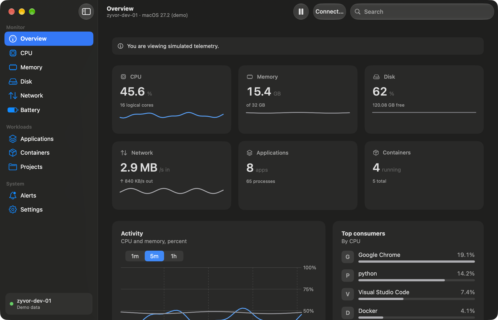
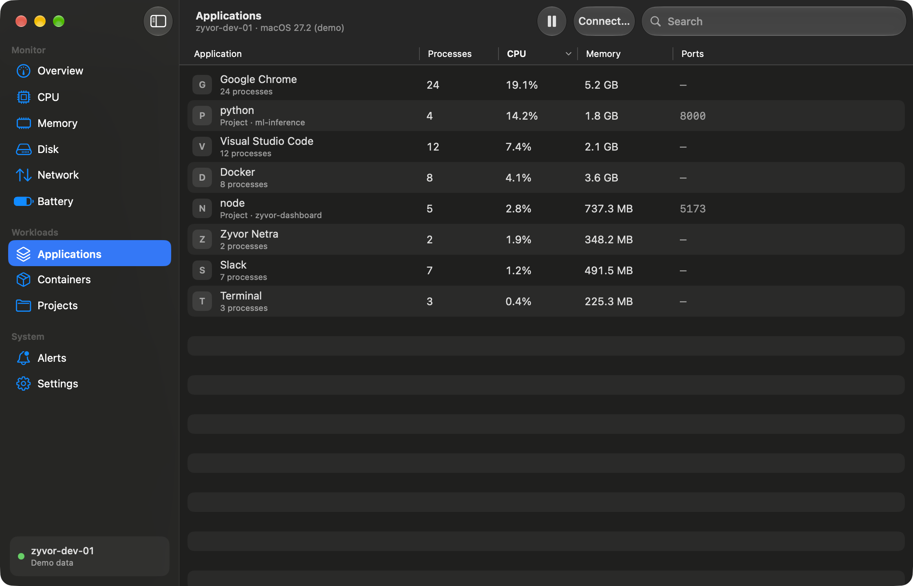
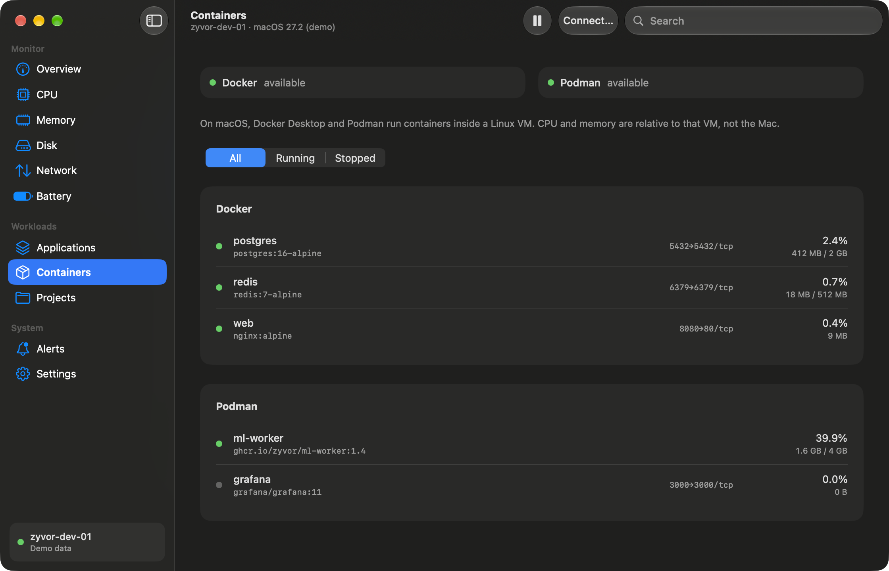

# Vytrix

### See what your machine is really doing.

**Vytrix is a read-only system activity monitor for macOS.** It groups processes by application, shows listening ports, project folders and containers, alerts you at a threshold you set, and lives in the menu bar. It never kills, signals or changes anything.

The Vytrix source code is private. This repository holds the documentation, the website and the downloads.

## Download

- **Build:** `Vytrix-0.9.0.dmg`, Developer ID signed and notarized by Apple.
- **Requires macOS 26 or later.**
- **Release:** https://github.com/zyvorai/vytrix/releases/tag/v0.9.0 (the SHA-256 is in the release notes and in `Vytrix-0.9.0.dmg.sha256`).
- **Website:** https://zyvorai.github.io/vytrix/

Open the DMG and drag Vytrix to Applications.

## Trial and licence

Free 30-day trial key: sales@zyvor.dev

Get a licence at https://zyvor.dev/buy. See [docs/COMMERCIAL-LICENSE.md](docs/COMMERCIAL-LICENSE.md) and [LICENSE](LICENSE) (Zyvor Production License v1.0).

## What is new in 0.9.0

- Capacity outlook
- Process inspector
- CSV export of Applications
- Menu bar disk and battery rows

See the [changelog](CHANGELOG.md).

## Screenshots

| Applications | Containers |
| --- | --- |
|  |  |

*Simulated telemetry, not a capture of a real machine.*

## Security

See [SECURITY.md](SECURITY.md). Report vulnerabilities to security@zyvor.dev.
